# Домашнее задание 16-01. Введение в Terraform

## Задание 1

### Пункт 1. Инициализация Terraform

Проверил установленные Terraform 1.14.8 и Docker 29.1.3.

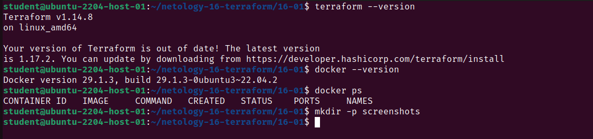

Скопировал исходные файлы проекта. В `main.tf` изменил ограничение версии Terraform на `>= 1.12.0`, так как установлена версия 1.14.8.

Выполнил инициализацию Terraform для ДЗ:

`terraform init`

Terraform скачал провайдеры `kreuzwerker/docker v4.7.0` и `hashicorp/random v3.9.1` из официального реестра Terraform. Доступ присутствует.

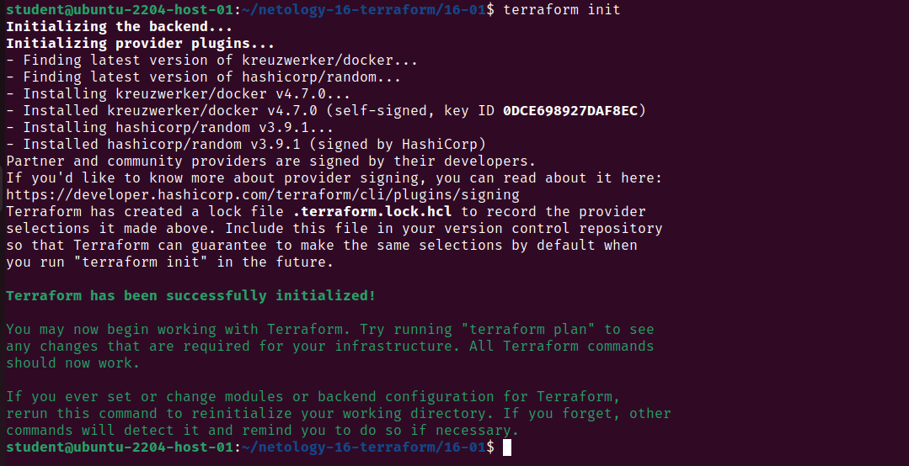


### Пункт 2. Файл .gitignore

Изучил `.gitignore`. Личные данные (пароли, токены, ключи) можно хранить в файле `personal.auto.tfvars`.

Этот файл указан в `.gitignore`, поэтому Git не будет добавлять его в репозиторий обычным способом.

Также добавил исключение `!.terraform.lock.hcl`, чтобы сохранять файл с версиями провайдеров в Git.


### Пункт 3. Создание ресурса random_password

Сначала сделал план выполнения Terraform командой:

`terraform plan`

Terraform показал: `1 to add, 0 to change, 0 to destroy`.

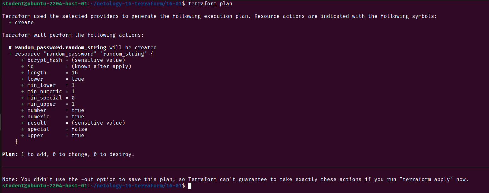

Затем выполнил `terraform apply` и подтвердил создание ресурса.

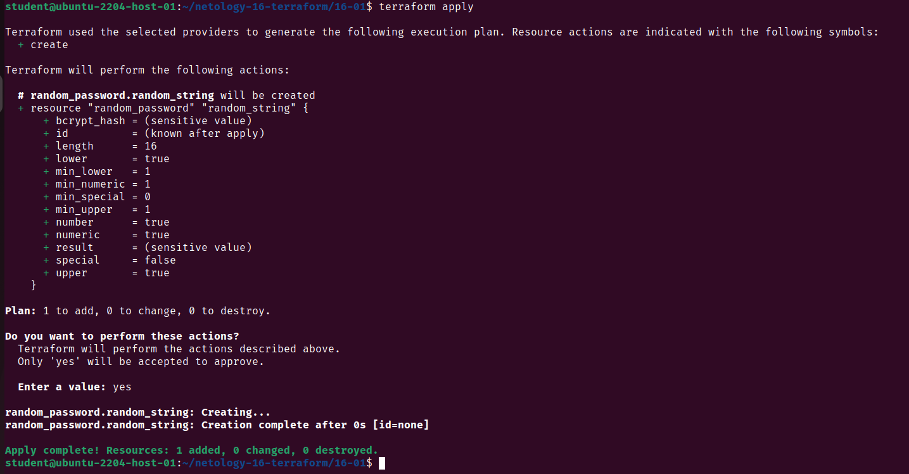

Открыл `terraform.tfstate` и нашёл сгенерированный пароль:

- Ресурс: `random_password.random_string`
- Ключ: `result`
- Значение: `Y5QLbKs0HtphSrI8`

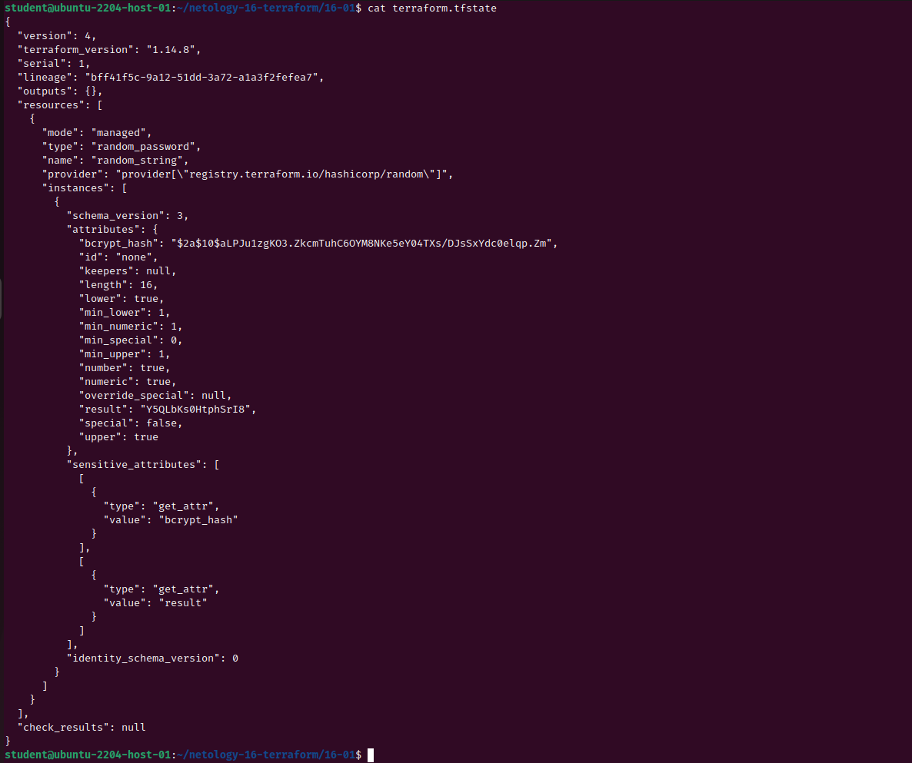

Пароль хранится в state-файле в открытом виде, хотя Terraform скрывает его в обычном выводе команд.


### Пункт 4. Проверка и исправление ошибок

Раскомментировал блоки Docker в `main.tf` и выполнил `terraform validate`.

Terraform обнаружил две ошибки:
1. У ресурса `docker_image` отсутствовало внутреннее имя.
2. Имя ресурса `1nginx` начиналось с цифры, что недопустимо.

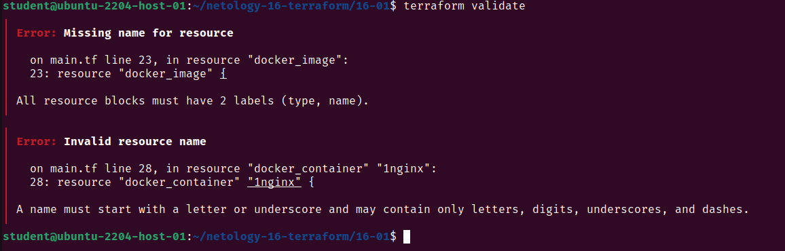

Исправил имена на `nginx_image` и `nginx_container`. При повторной проверке обнаружилась ошибка ссылки на несуществующий ресурс `random_string_FAKE`.

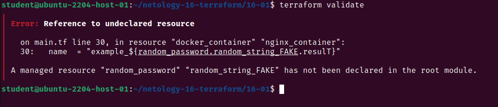

Исправил ссылку на `random_password.random_string.result`, а также обращение к Docker-образу.

После исправлений повторно выполнил `terraform validate`. Конфигурация прошла проверку успешно.

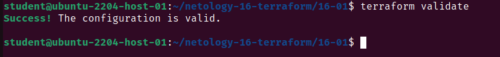


### Пункт 5. Создание Docker-контейнера

Выполнил `terraform plan`, затем `terraform apply`.

Первый запуск завершился ошибкой: порт `9090` уже занят Prometheus. Изменил внешний порт на `9092` и повторно выполнил `terraform apply`.

Terraform заменил неработающий контейнер новым.

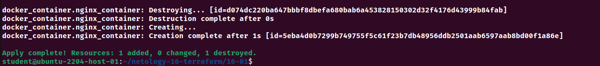

Исправленный фрагмент `main.tf`:

```hcl
resource "docker_image" "nginx_image" {
  name         = "nginx:latest"
  keep_locally = true
}

resource "docker_container" "nginx_container" {
  image = docker_image.nginx_image.image_id
  name  = "example_${random_password.random_string.result}"

  ports {
    internal = 80
    external = 9092
  }
}
```

Проверил контейнер командой `docker ps`. Контейнер запущен, порт `9092` проброшен на порт `80`.

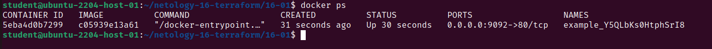


### Пункт 6. Переименование контейнера

В `main.tf` изменил имя Docker-контейнера на `hello_world`, при этом образ оставил `nginx:latest`.

Проверил изменения через `terraform plan`, затем выполнил:

`terraform apply -auto-approve`

Terraform удалил старый контейнер и создал новый с именем `hello_world`.

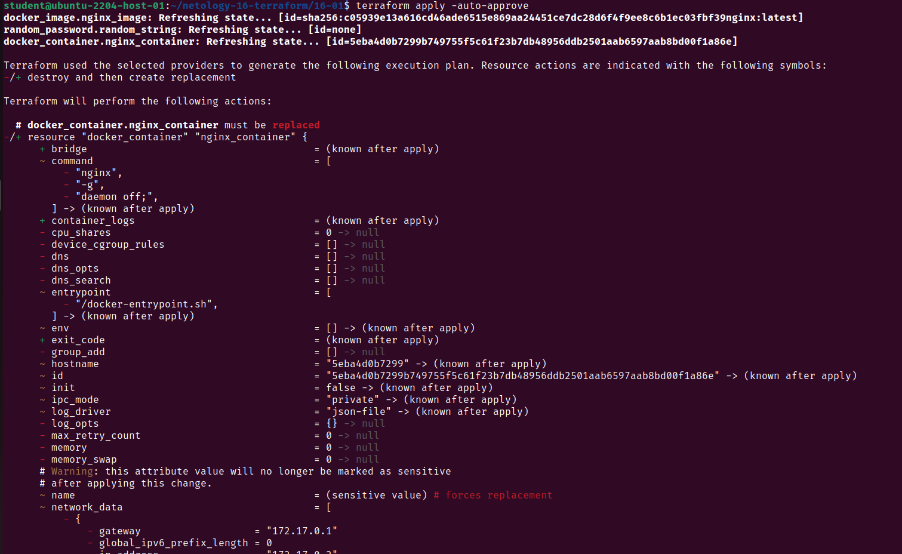

Ключ `-auto-approve` позволяет применять изменения без ручного подтверждения `yes`. Это удобно при автоматическом запуске Terraform, например в CI/CD.

Опасность в том, что Terraform может удалить или изменить ресурсы без дополнительного подтверждения. Поэтому перед применением изменений важно проверять план.

Проверил результат командой `docker ps`. Контейнер `hello_world` работает на порту `9092`.

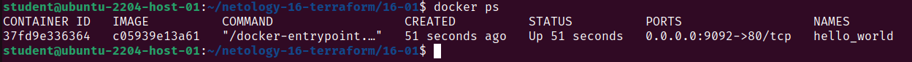


### Пункт 7. Удаление ресурсов Terraform

Сначала проверил план удаления:

`terraform plan -destroy`

Terraform показал: `0 to add, 0 to change, 3 to destroy`.

Затем выполнил `terraform destroy` и подтвердил удаление.

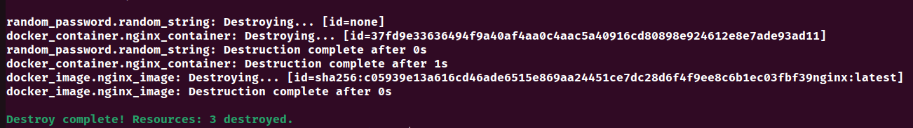

Проверил результат командами:

`terraform state list`

`docker ps`

`cat terraform.tfstate`

Список ресурсов Terraform пустой, запущенных контейнеров нет.

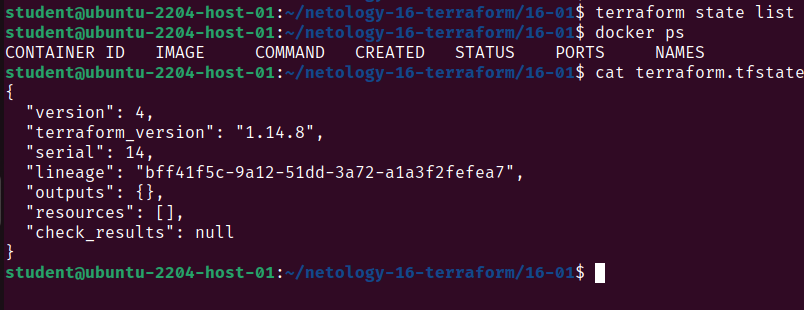


### Пункт 8. Сохранение Docker-образа

После `terraform destroy` проверил наличие образа:

`docker image ls nginx:latest`

Образ `nginx:latest` остался на диске.

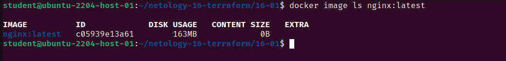

Причина в параметре `keep_locally = true`, который указан в ресурсе `docker_image` файла `main.tf`.

В [документации Docker Provider](https://library.tf/providers/kreuzwerker/docker/latest/docs/resources/image) указано:

> If true, then the Docker image won't be deleted on destroy operation.

Таким образом, Terraform удалил ресурс из своего состояния, но сам Docker-образ сохранил локально.


